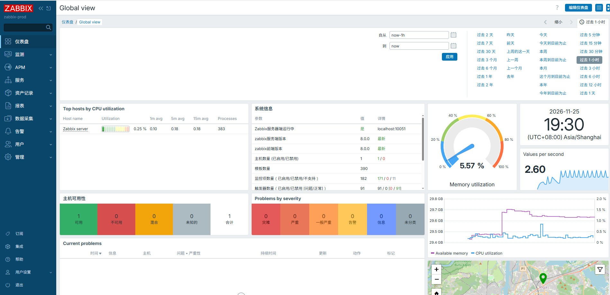

# Zabbix Ubuntu 26.04 QuickInstall

**Zabbix 8.0 LTS（当前最新长期支持版）在 Ubuntu 26.04 (Resolute) 上的一键部署脚本。**

遵循 [Zabbix 官方安装文档](https://www.zabbix.com/download) 的标准流程，支持：



- 🌐 **外网在线安装**：直接从 `repo.zabbix.com` 官方源安装
- 🏢 **内网离线安装**：先在有外网的机器上制作离线包，再拷贝到内网服务器安装
- 🔒 生产环境加固项：随机强数据库密码、日志留痕、服务自检、防火墙放行

---

## 功能特性

| 特性 | 说明 |
|---|---|
| 双模式安装 | 在线 / 离线（`--offline`）同一脚本 |
| 组件 | Zabbix Server + Web 前端 + Agent2（可选经典 Agent） |
| 数据库 | MySQL 8（本机自动安装配置，或 `--db-host` 指定远程库） |
| Web 服务器 | Apache（默认）或 Nginx（`--webserver nginx`） |
| 密码管理 | 未指定时自动生成 24 位强密码，保存至 `/root/.zabbix-db-password` |
| 非交互部署 | 支持 `--config` 配置文件 + `--non-interactive`，适合批量/CI |
| 安全日志 | 全程输出记录到 `/var/log/zabbix-install.log`（600 权限） |
| 自检 | 安装后自动验证服务状态与启动日志，失败即报错 |
| 可重入 | 失败后修复问题可直接重跑 |

---

## 快速开始（外网服务器）

```bash
git clone https://github.com/<your-username>/zabbix-ubuntu26-quickinstall.git
cd zabbix-ubuntu26-quickinstall
sudo bash install-zabbix.sh
```

安装完成后：

- 访问 `http://<服务器IP>/zabbix`
- 默认账号 `Admin / zabbix` —— **登录后立即修改密码！**
- 数据库凭据在 `/root/.zabbix-db-password`

### 常用参数

```bash
# 指定数据库密码与时区
sudo bash install-zabbix.sh --db-password 'S3cret!' --timezone Asia/Shanghai

# Nginx 前端 + 经典 Agent
sudo bash install-zabbix.sh --webserver nginx --agent

# 使用远程 MySQL（需提供 root 密码）
sudo bash install-zabbix.sh --db-host 10.0.0.8 --db-root-password 'RootPass'

# 不动防火墙
sudo bash install-zabbix.sh --no-firewall
```

<details>
<summary>全部参数</summary>

| 参数 | 默认值 | 说明 |
|---|---|---|
| `--version <ver>` | `8.0` | Zabbix 主版本 |
| `--db-password <pass>` | 自动生成 | zabbix 数据库用户密码 |
| `--db-host <host>` | `localhost` | MySQL 地址，localhost 表示本机 |
| `--db-root-password <p>` | 空 | 远程数据库时必填 |
| `--webserver <ws>` | `apache` | `apache` 或 `nginx` |
| `--agent2` | 默认 | 安装 zabbix-agent2 |
| `--agent` | — | 改装经典 zabbix-agent |
| `--timezone <tz>` | `Asia/Shanghai` | 系统/PHP 时区 |
| `--no-firewall` | — | 跳过防火墙配置 |
| `--data-dir <dir>` | `/data` | 持久化数据根目录：MySQL 数据目录迁至 `<dir>/mysql`，备份目录 `<dir>/zabbix/backup` |
| `--innodb-buffer-pool <s>` | — | 设置 innodb_buffer_pool_size（生产建议内存的 50–70%，如 `12G`） |
| `--offline <dir\|tar.gz>` | — | 离线安装模式 |
| `--config <file>` | — | 从配置文件读取参数 |
| `--non-interactive` | — | 非交互模式（全部用参数/默认值） |

</details>

---

## 内网离线部署

适用场景：目标服务器**无法访问任何外网源**（既不通 `repo.zabbix.com`，也不通 Ubuntu 归档源）。

### 第 1 步：在有外网的 Ubuntu 26.04 机器上制作离线包

```bash
sudo bash make-offline-package.sh
# 可选：sudo bash make-offline-package.sh --webserver nginx --agent
```

生成 `zabbix-offline-8.0-ubuntu26.04-amd64-<日期>.tar.gz`（含全部 deb 依赖 + SHA256 校验）。

> 注意：制作机的 **系统版本（26.04）和架构（amd64/arm64）必须与目标内网服务器一致**。

**制作完成后请务必确认包的完整性**（这是踩过的坑）：

```bash
f=zabbix-offline-8.0-ubuntu26.04-amd64-20260101.tar.gz
tar tzf $f | grep -c '\.deb$'                 # 正常应 ≥ 200 个（约 142MB）
tar tzf $f | grep -E 'mysql-server-core|mysql-server_|php8.5-fpm'   # 三个都必须在
```

> v1.0.0 及更早版本制作的离线包**只有 7 个 deb**（缺 `mysql-server-core` 等依赖），
> 在内网机上会装出「没有 `mysqld`、没有 `mysql.service`」的残缺 MySQL。
> 请使用 **v1.0.1 或更新版本**的 `make-offline-package.sh` 重新制作。

### 第 2 步：拷贝到内网服务器并安装

```bash
# 用 U 盘 / 内网 scp 传输后：
sha256sum -c zabbix-offline-8.0-ubuntu26.04-amd64-xxx.tar.gz.sha256   # 校验
sudo bash install-zabbix.sh --offline zabbix-offline-8.0-ubuntu26.04-amd64-xxx.tar.gz
```

脚本会用 `dpkg -i` 一次性安装包内全部组件，随后自动建库、导数据、迁移数据目录到 `/data`、
启动服务并自检。全程日志在 `/var/log/zabbix-install.log`。

### 第 3 步：Web 初始化

浏览器访问 `http://<内网服务器IP>/zabbix`：

| 字段 | 填什么 |
|---|---|
| Database host / port | `localhost` / `0`（本机 socket，不改） |
| Database name / User | `zabbix` / `zabbix`（不改） |
| **Password** | 服务器上 `cat /root/.zabbix-db-password` 里的 `DBPassword` |
| **Default time zone**（下一页） | **手动选 `Asia/Shanghai`**，不要用默认的 `System: UTC` |

完成后用 `Admin / zabbix` 登录，**立即改密码**，并在 *User settings → Language* 切换到简体中文。

---

## 非交互 / 批量部署

```bash
cp config.example.conf my.conf && vi my.conf
sudo bash install-zabbix.sh --config my.conf --non-interactive
```

---

## 生产环境加固清单

安装只是第一步，上线前建议完成：

1. **改默认口令**：前端 `Admin` 密码、数据库密码都用强密码
2. **HTTPS**：`certbot --apache`（外网）或企业证书 + 强制 443 跳转
3. **端口收敛**：公网只放行 80/443；10051 仅对被监控网段开放；10050 仅内网
4. **MySQL 调优**：`innodb_buffer_pool_size` 设为物理内存 50–70%
5. **定时备份**：每日 `mysqldump zabbix` + `/etc/zabbix/` 配置目录
6. **规模扩大时**：加装 TimescaleDB、部署 Zabbix Proxy 分担采集

## 系统要求

- Ubuntu 26.04 (Resolute)，amd64 / arm64
- 建议 ≥ 4 vCPU / 8 GB RAM / SSD，系统盘 ≥ 40 GB
- 离线包约 142 MB（259 个 deb）；建议把 `/data` 放在独立数据盘
- 外网模式需要能访问 `repo.zabbix.com` 和 Ubuntu 官方源

## 常见问题

<details>
<summary>安装后前端打不开？</summary>

- 检查防火墙/云安全组是否放行 80（或 443）
- `systemctl status apache2 nginx php*-fpm` 确认服务在跑
- Apache 模式需 `a2enmod proxy proxy_fcgi`（脚本已自动执行）
</details>

<details>
<summary>zabbix-server 起不来？</summary>

- `tail -50 /var/log/zabbix/zabbix_server.log`
- 多为数据库密码错误或 schema 未导入完成，修正后重启即可
- 脚本可安全重跑，已导入的数据不会重复导入（`CREATE ... IF NOT EXISTS`）
</details>

<details>
<summary>离线安装报 <code>Unit mysql.service not found</code> / <code>Failed to start the MySQL service</code>？</summary>

**原因**：离线包不完整，缺 `mysql-server-core`（`mysqld` 二进制所在包）。表现为
`/usr/sbin/mysqld` 不存在、`/var/lib/mysql` 不存在、`systemctl cat mysql` 找不到单元文件。

先用两条命令确认：

```bash
ls -l /usr/sbin/mysqld; systemctl cat mysql >/dev/null 2>&1 && echo "单元存在"
dpkg -l | grep -E '^i[^i]|mysql-server-core'
```

**修复（二选一）**：

1. 内网机**有可用的 apt 源**时，直接补齐再重跑：

   ```bash
   apt-get install -y --reinstall mysql-server-core mysql-server
   systemctl start mysql && echo OK
   sudo bash install-zabbix.sh --offline <原离线包.tar.gz>   # 可重入，直接重跑
   ```

2. 彻底解决：用 **v1.0.1+** 的 `make-offline-package.sh` 重新制作离线包（内含完整依赖闭包），
   拷过去重跑安装脚本。
</details>

<details>
<summary>zabbix-agent2 启动失败（Server 正常）？</summary>

不影响监控平台本身运行，只影响本机自监控。排查顺序：

```bash
journalctl -u zabbix-agent2 -n 30 --no-pager   # 先看真实报错
ss -tlnp | grep 10050                          # 端口是否被占用
zabbix_agent2 -T 2>&1 | tail -20               # 配置自检
```

常见原因是 10050 端口冲突或配置项非法；修正后 `systemctl restart zabbix-agent2` 即可。
</details>

<details>
<summary>想装 7.0 LTS / 7.4？</summary>

```bash
sudo bash install-zabbix.sh --version 7.0
```
</details>

## 变更记录

### v1.0.1（2026-11-26）

- **修复：离线包不完整**（严重）。`make-offline-package.sh` 原先用 `apt-get --reinstall` 只重新下载
  显式列出的包，其依赖因制作机上已安装而被 apt 跳过，导致离线包只有 7 个 deb，内网机上 MySQL
  装出残缺状态（无 `mysqld`、无 `mysql.service`）。现改为 `-o Dir::State::status=<空文件>` 把制作机
  视为裸机，下载**完整依赖闭包**（约 259 个 deb / 142 MB），并增加 `mysql-server-core` 存在性断言。
- 文档补充：离线包完整性校验方法、离线安装失败排查、Web 初始化逐字段说明。

### v1.0.0（2026-11-25）

- 首个版本：Zabbix 8.0 LTS + MySQL 8 + Apache/Nginx + Agent2 一键部署，在线/离线双模式，
  `--data-dir` 统一持久化目录，自动生成 locale 支持中文界面，通过真实服务器端到端实测。

## License

[MIT](LICENSE)

## 致谢

- [Zabbix LLC](https://www.zabbix.com/) — 官方安装文档与软件源
- 社区脚本参考：[X-Mars/Quick-Installation-ZABBIX](https://github.com/X-Mars/Quick-Installation-ZABBIX)、[databloat/zabbix-full-deployer](https://github.com/databloat/zabbix-full-deployer)
